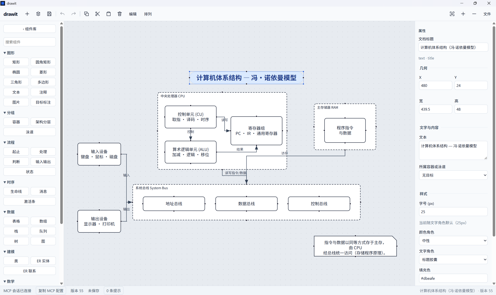
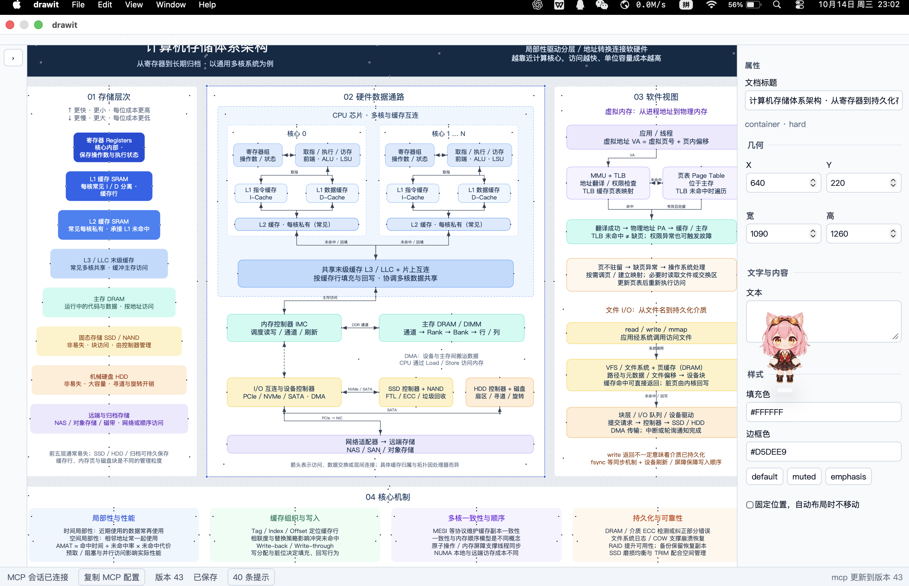

# drawit

[](https://github.com/wrongtrojan/drawit)
[](docs/mcp.md)
[](https://v2.tauri.app/)
[](https://nodejs.org/)
[](https://pnpm.io/)
[](docs/gui.md)
[](LICENSE)

drawit 是面向 Agent 设计的本地示意图编辑器， 通过 MCP 接口给 Agent 提供示意图元素与操作方法，通过 GUI 界面为人工提供交互式编辑体验。

预设的交互方式为：人工为 Agent 提供 prompt，Agent 使用 MCP 绘制示意图，随后人工检查示意图是否符合预期，若偏差较小则人工快速通过 GUI 修改。

项目桌面端基于 **Tauri 2**，目前提供 Windows / macOS 安装包，Linux 暂未实机测试，需 [自行编译](docs/maintenance.md#安装包构建)。项目当前处于早期阶段，欢迎反馈与贡献。

## 桌面版快照

图为 Windows 端使用 cursor composer 2.5 绘制的计算机体系结构图，prompt 为 *"请使用 drawit 绘制一张计算机体系结构图"*。



图为 Mac 端使用 gpt6-sol 绘制的计算机存储体系结构图, prompt 为 *"请使用 drawit 绘制一张计算机存储体系结构图, 要求内容详尽, 且样式美观"*。



## 支持的元素与操作

> 偏向 数学/计算机/AI 等技术领域

| 类别 | 元素 |
| --- | --- |
| 图形 | 矩形、圆角矩形、椭圆、菱形、三角形、多边形、文本、注释、图片、目标标注 |
| 分组 | 容器、架构分层、泳道 |
| 流程 | 起止、处理、判断、输入输出、状态 |
| 时序 | 生命线、消息、激活条 |
| 数据 | 表格、数组、栈、队列、树、图 |
| 建模 | 类、ER 实体、ER 联系 |
| 数学 | 数轴、张量、公式、标题胶囊、运算符、矩阵、向量、括号、公式注释 |
| 时间 | 里程碑 |

连线支持直线、正交折线、曲线与贝塞尔；表格支持单元格合并。

可以撤销、重做、组合、对齐、分布、吸附到网格和自动布局。工程保存为 `.drawit.json`，并可以导出 SVG 或 PNG。

## 快速开始

**安装版**：从 [GitHub Releases](https://github.com/wrongtrojan/drawit/releases) 下载对应平台安装包；首次启动会打开二分查找示例。

**从源码**（Node.js 20+、pnpm 10+）：

```sh
pnpm install
pnpm dev
```

`pnpm dev` 为 Web 壳，浏览器访问 `http://127.0.0.1:1420`。完整桌面壳（原生文件对话框、单实例等）：

```sh
pnpm --filter @drawit/desktop tauri dev
```

打安装包与其它维护步骤见 [docs/maintenance.md](docs/maintenance.md)。

GUI 使用方式，见 [docs/gui.md](docs/gui.md)。将 drawit 接入 Agent 工具，见 [docs/mcp.md](docs/mcp.md)。

## 文档

| 文档 | 内容 |
| --- | --- |
| [docs/gui.md](docs/gui.md) | GUI 使用方式 |
| [docs/mcp.md](docs/mcp.md) | MCP 配置、调用顺序和工具 |
| [docs/maintenance.md](docs/maintenance.md) | 维护指南 |
| [docs/scenarios.md](docs/scenarios.md) | 常用场景范例 |
| [docs/academic.md](docs/academic.md) | 学术场景范例 |

## 许可

本项目采用 [GNU General Public License v3.0 或更高版本](LICENSE)（GPL-3.0-or-later）。随包字体见 [assets/fonts/OFL.txt](assets/fonts/OFL.txt)（SIL Open Font License）。