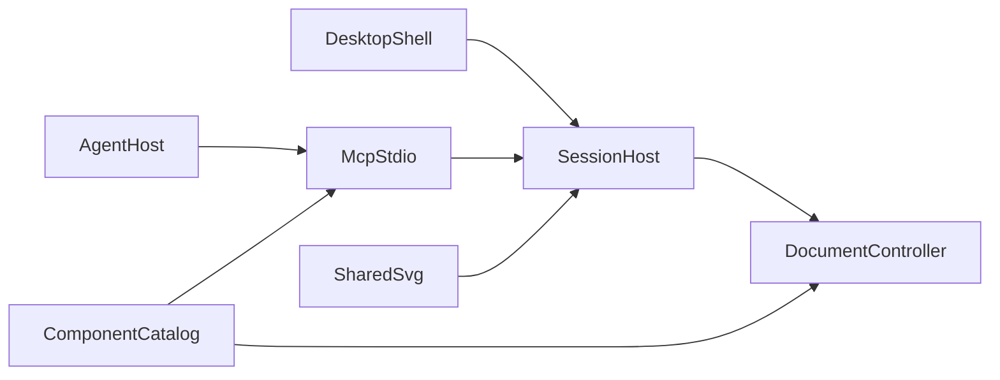

# drawit 演进说明

这份文档给后续开发用。它固定已经验证过的架构，并把接下来的工作分成四条可以并行的线。绘图回归样本见 [scenarios.md](scenarios.md)。本地如何运行见 [development.md](development.md)。面向使用者的说明将写在 `docs/guide.md`。

## 已经验证的基线

不要重做下面这些决定。

- 唯一事实来源是 `DiagramDocument`。界面手势和 MCP 工具都编译成 `DiagramOperation`，进入 `packages/core/src/controller.ts` 的单写队列。React Flow 只是投影。
- `revision` 只在内容提交时加一。选择、视口、悬停不增加版本。撤销和重做是一次新的提交，版本号继续增加。
- 变更必须带 `expectedRevision`。不一致时返回 `REVISION_CONFLICT` 和当前版本，文档不变。不提供用旧快照覆盖整份文档的工具。
- 批量操作在副本上执行。结构校验失败则整批丢弃。
- 打开中的文档只存在于桌面应用拉起的 Session Host。Host 绑定 `127.0.0.1` 随机端口，把 `{ port, token, pid }` 写入用户数据目录的 `session.json`。MCP 是另一个 stdio 进程，只做校验和转发。
- 编辑器未打开时，MCP 用同一个 `DocumentController` 短时读写文件。编辑器已打开时，禁止 MCP 直接改该文件。`diagram_open_editor` 在编辑器未运行时返回 `EDITOR_NOT_RUNNING`，它不负责启动窗口。
- 编辑器不轮询磁盘覆盖内存。外部文件变化只提示，等用户明确重新加载。
- 预览、画布、导出和视觉自检共用 `packages/render` 的 SVG。审查图由 `diagram_review_snapshot` 以 MCP `image` 交回调用中的模型。工具成功只表示图已生成。
- 不执行 Agent 提供的脚本或 HTML。不接云端识图，不上传图。

错误码保持：`REVISION_CONFLICT`、`NOT_FOUND`、`VALIDATION_ERROR`、`SCHEMA_INCOMPATIBLE`、`EDITOR_NOT_RUNNING`、`PATH_FORBIDDEN`、`TRANSACTION_FAILED`、`EXPORT_FAILED`。重复 ID、悬空端点、非法尺寸和坏掉的父子关系是错误。重叠、越界和文本溢出是警告，不阻止保存。

## 工作流

四条线可以同时做。组件目录的 schema 要先稳定，`diagram_catalog` 再读它。桌面随包会话不能改现有 WebSocket 协议。建议先让合作者能跑起来：桌面开箱和协议测试，然后 MCP 发现能力，再编辑器体验，最后扩展图元。

### 1. 图元与生成场景

现状：注册表在 `packages/core/src/registry.ts`。已有基础形状、四种流程图节点、数组、栈、队列、树、图、公式、矩阵、向量和括号。树和图的渲染是近似布局。没有时序图、类图、ER、泳道、表格、架构分层和从注释指向目标的箭头。

目标：新场景都登记在同一注册表里，带类型、分类、默认几何、属性 schema 和额外校验，并由同一个 SVG 渲染器绘制。语义属性留在节点上，不拆成无法还原的匿名矩形。优先补这些，因为它们覆盖 Agent 最常被要求的图：

- 时序图：生命线、消息、激活条
- 分层架构：容器内的分组块和单向依赖
- 表格：表头、单元格，以及基本的合并
- 标注：从注释指向目标节点的箭头
- 对齐、分布、吸附到网格。这些是显式操作，不在每次编辑后自动重排。`pinned` 节点在自动布局时保持原位。

公式在画布里用 KaTeX HTML，`trust` 保持关闭。审查 PNG 目前用 `equationMode: "text"`，模型看到的是 LaTeX 源码。审查图也要光栅出排好的公式。用户导出的 SVG 仍然保存 LaTeX 源码。

验收：

- 新类型能经 MCP 创建、经界面编辑、经保存后重新打开，ID 和语义字段不变。
- [scenarios.md](scenarios.md) 里对应领域的简略和详尽两条都能画完，审查图能看出要求的关系。
- 自动布局仍然只在显式调用时运行，并跳过 `pinned` 节点。

这一阶段不做：手绘、多页、云端素材、从磁盘加载任意插件脚本。

### 2. 编辑器体验

现状：`apps/desktop/src/App.tsx` 只处理 Ctrl/Cmd+Z、Ctrl/Cmd+S 和 Delete。打开文档是 `window.prompt` 输入文档 ID。工具栏是一排文字按钮，样式在 `apps/desktop/src/styles.css`，没有图标，也没有快捷键提示。

键盘全部编译成已有的 `DiagramOperation` 或会话请求。焦点在输入框、文本域或下拉框时不抢键。macOS 用 Cmd，其他系统用 Ctrl。

| 按键 | 作用 |
| --- | --- |
| Ctrl/Cmd+Z | 撤销 |
| Ctrl/Cmd+Shift+Z 或 Ctrl/Cmd+Y | 重做 |
| Ctrl/Cmd+S | 保存 |
| Ctrl/Cmd+C / X / V | 复制、剪切、粘贴选中对象 |
| Ctrl/Cmd+D | 原位复制 |
| Ctrl/Cmd+A | 全选 |
| Ctrl/Cmd+G | 组合 |
| Delete 或 Backspace | 删除选中对象 |
| 方向键 | 将选中节点轻移一个网格 |
| Ctrl/Cmd+0 | 适应画布 |
| Ctrl/Cmd+加号 / 减号 | 放大、缩小 |
| Esc | 取消选择 |

按钮和菜单显示对应快捷键。打开改为文档列表，而不是手填 ID。界面改成紧凑的浅色桌面工具：图标工具栏、可折叠组件库、属性面板按几何、文字和样式分组，状态栏保留版本、脏标记和 MCP 连接状态。不做主题系统。未接通的能力不要留空按钮。

另写 `docs/guide.md`，给使用的人：如何新建和保存、文件放在哪、快捷键、如何把图交给 Agent。开发者仍看 `docs/development.md`。

验收：上表每一键在非输入焦点下生效；输入框里打字不会触发删除或撤销；保存后再打开，内容和 ID 不变。

### 3. MCP 对 Agent 的可发现性

现状：15 个工具的英文描述在 `packages/mcp/src/tools.ts`。没有服务器级说明，没有组件目录工具，写工具没有示例参数。没有 `diagram_save`。编辑器有未保存修改时，新建或切换会被拒绝，Agent 无法自己解开。审查工具成功时，模型容易把它当成画面已经合格。

目标：

- `McpServer` 写入固定 instructions：先 `diagram_get` 或 `diagram_get_view` 读取版本和对象 id；修改带上 `expectedRevision`；布局或一批修改之后调用 `diagram_review_snapshot`；查看重叠、裁切、出界、箭头和标签；不合适时用对象 id 做局部更新并再次审查。工具成功只表示图已生成。
- 新增只读 `diagram_catalog`。它返回类型、适用场景、必填字段和一条最小示例。数据来自注册表，不在工具描述里再抄一份。
- 每个写工具补一条短示例，并写明 `REVISION_CONFLICT`、`VALIDATION_ERROR`、`EDITOR_NOT_RUNNING` 时文档是否改变。
- 新增 `diagram_save`，显式保存当前打开的图。它不改变几何。保存后 `dirty` 为假，才允许切换文档。
- 协议保持客户端今天使用的 2025 年 `initialize`。`serveStdio` 继续以 legacy 模式提供服务，同时接受 `2026-07-28` 的现代信封。进程内握手测试要覆盖 `2024-11-05`、`2025-03-26`、`2025-06-18` 和带现代信封的初始化。不要发布只接受新信封的构建。
- 可被 Cursor 拉起的入口是用 `tsx` 运行 `packages/mcp/src/index.ts`。当前 esbuild 单文件会在 `ws` 的动态 `require` 上崩溃，不要把那个产物当作客户端入口，除非这个问题先被测试挡住。

日志只写 stderr。stdio 上不打日志。

验收：一个只读到工具描述和 `diagram_catalog` 的客户端，能在没有额外口头说明的情况下完成 [scenarios.md](scenarios.md) 里任意一条简略提示；过期 `expectedRevision` 被拒绝且图不变；审查结果同时含 PNG 图像块和带 id 的清单。

### 4. 跨平台开箱桌面端

现状：`apps/desktop/src-tauri/tauri.conf.json` 只打 Windows NSIS。安装包不包含会话进程，用户仍要自己安装 Node 再运行 `pnpm dev`。端口是随机的，写在 `session.json`，界面不能复制 MCP 配置。现在的 Cursor 配置还写死了某一台机器上的 `node.exe` 路径。数据目录在 Windows 上使用 `%APPDATA%`。

目标：

- 桌面壳启动时拉起随包的 Session Host，退出时关掉。用户不安装 Node，不手填端口。Host 仍然只监听 `127.0.0.1`。
- 状态栏提供“复制 MCP 配置”。按当前系统生成 Cursor 和 Claude Desktop 可粘贴的 JSON。命令是随包的 drawit MCP 可执行文件，而不是开发机上的 Node 路径。
- 数据目录：macOS 用 `Application Support`，Linux 用 XDG，Windows 继续用 `%APPDATA%`。`DRAWIT_HOME` 仍然可以改位置。
- 安装包：Windows NSIS、macOS dmg、Linux deb 或 AppImage。图标补齐各平台需要的尺寸。
- 复制出来的配置在对应系统上能完成一次 `initialize` 和 `tools/list`。编辑器已打开时，工具改的是正在看的那份图。编辑器未打开时，`diagram_open_editor` 返回 `EDITOR_NOT_RUNNING`。

验收：在一台没有全局 Node 的机器上安装后能打开二分查找示例；复制配置后，Agent 能连上并读到当前 `revision`。

## 非目标

不做账号、云同步、付费识图、Agent 提交的 JavaScript，也不做用旧快照覆盖整份文档。未完成的能力写在文档里，不留空按钮。

## 如何验收

从 [scenarios.md](scenarios.md) 抽条目。Agent 只看到那一条提示词，人再看审查图。通过标准写在每条下面。新增图元时，至少让对应领域的简略和详尽两条都能画完。
