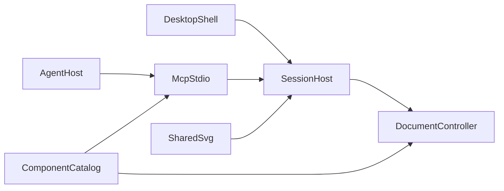

# 维护指南

这份文档给修改 drawit 的人，说明架构、目录、检查和打包。使用界面见 [guide.md](guide.md)，接入 Agent 见 [mcp.md](mcp.md)，绘图样本见 [scenarios.md](scenarios.md)。

## 架构

唯一事实来源是 `DiagramDocument`。界面手势和 MCP 工具都变成 `DiagramOperation`，进入 `packages/core/src/controller.ts` 的单写队列。React Flow 是这份文档的投影。磁盘上保存文档；选择、视口和悬停留在界面里。

- `revision` 在内容提交时加一。选择、视口和悬停不增加版本。撤销和重做是一次新提交，版本继续增加。
- 修改带 `expectedRevision`。版本不一致时返回 `REVISION_CONFLICT`，文档保持原样。已有文档只通过这些操作更新。
- 一批操作在副本上执行。结构错误则整批丢弃。重叠、越界和文字溢出是警告，不阻止保存。
- 打开中的文档只在 Session Host 里。Host 监听 `127.0.0.1` 的随机端口，把端口、令牌和进程号写入数据目录的 `session.json`。
- MCP 是另一个 stdio 进程。编辑器开着时，工具只转发到会话。编辑器关着时，同一个控制器读写文件。`diagram_open_editor` 不启动窗口；编辑器未运行时返回 `EDITOR_NOT_RUNNING`。
- 磁盘上的文件有变化时只提示。用户点击“重新加载”后，内存换成磁盘内容，版本号继续增加。
- 预览、画布、导出和审查图共用 `packages/render` 的 SVG。审查结果是 MCP 图像；成功表示图已经生成。
- Agent 提交的脚本和 HTML 保存在文档中，运行时不会执行。公式使用 MathJax 路径 SVG；不接入 HTML、require、autoload 扩展，不在图内执行 HTML。浏览器与会话渲染在可终止的工作线程内进行。

错误码：`REVISION_CONFLICT`、`NOT_FOUND`、`VALIDATION_ERROR`、`SCHEMA_INCOMPATIBLE`、`EDITOR_NOT_RUNNING`、`PATH_FORBIDDEN`、`TRANSACTION_FAILED`、`EXPORT_FAILED`。



## 目录

- `apps/desktop`：React 界面和 Tauri 壳
- `packages/core`：文档 schema、操作、控制器、校验、组件注册表
- `packages/layout`：显式调用的 ELK 布局，跳过 `pinned` 节点
- `packages/render`：由文档生成 SVG 和 PNG
- `packages/session`：本机 WebSocket 会话
- `packages/mcp`：stdio 工具
- `examples`：经正常打开路径载入的示例工程
- `docs`：使用指南、MCP 接入、本维护指南和绘图样本
- `scripts`：开发服务器、运行时打包和检查

## 增加一种图元

1. 在 `packages/core/src/schema.ts` 增加节点类型和字段。未知字段收进 `meta`。更高且不兼容的 `schemaVersion` 直接拒绝。
2. 在 `packages/core/src/document.ts` 写默认几何。
3. 在 `packages/core/src/registry.ts` 登记类型、分类、默认值和关键词，并在 componentGuidance.ts 写适用情形、语义字段和组合顺序。`diagram_catalog` 读取这份登记。
4. 在 `packages/core/src/contentLayout.ts` 接入需要随内容变化的尺寸；projectSemanticNode 是统一投影入口。再在 `packages/render/src/svg.ts` 用同一渲染器画出语义外观。语义字段留在节点上。
5. 在 `apps/desktop/src/SemanticFields.tsx` 接入语义字段编辑，由 `Properties.tsx` 展示。特殊形状的连接边界写在 core 的 `nodeConnectionBox`，画布 Handle 和导出连线使用同一规则。
6. 补 schema、往返保存和渲染测试。需要 Agent 回归时，在 `docs/scenarios.md` 增加一条代表提示，并在 `examples/` 放同名工程。

自动布局只在显式调用时运行。父子坐标与 React Flow 一致：没有父节点时相对画布，有 `parentId` 时相对父容器。

## 运行与检查

需要 Node.js 20+ 和 pnpm 10+。打包还需要 Rust stable，以及 Windows 的 Visual Studio C++ 与 WebView2、macOS 的 Xcode Command Line Tools，或 Linux 的 WebKitGTK 构建依赖。

```sh
pnpm install
pnpm dev
```

界面在 `http://127.0.0.1:1420`。桌面壳：

```sh
pnpm --filter @drawit/desktop tauri dev
```

提交前运行：

```sh
pnpm test
pnpm typecheck
```

涉及随包运行时或安装包时再运行：

```sh
pnpm bundle:runtime
pnpm test:runtime
pnpm --filter @drawit/desktop tauri build
```

`test:runtime` 会清空子进程 PATH，检查随包 Node、握手、工具目录、示例文档、审查 PNG，以及 Host 退出后的离线错误。集成测试使用本机 loopback 端口。

## 语义图元回归

`packages/core/src/semantic.test.ts` 检查目录示例、字段编辑、文件往返、过期版本和非法数据回滚。`packages/render/src/semantic.test.ts` 检查 `examples/` 里的工程，以及树和图的结构。`apps/desktop` 的 `SemanticFields.test.tsx` 检查属性编辑。`packages/mcp/src/semantic.test.ts` 检查会话转发和未知类型拒绝。

```sh
pnpm examples
pnpm test
pnpm typecheck
pnpm --filter @drawit/desktop build
```

`pnpm examples` 把 `examples/` 里的工程渲染到 `examples/fig`。需要逐图检查关系、文字和箭头，再按 id 修改。生成成功只表示图已写出。

## 数据目录

默认位置：

- Windows：`%APPDATA%\drawit`
- macOS：`~/Library/Application Support/drawit`
- Linux：`$XDG_DATA_HOME/drawit`，未设置时是 `~/.local/share/drawit`

`DRAWIT_HOME` 覆盖上述位置。覆盖之后，编辑器和 MCP 使用同一个目录。使用者看到的工程路径见 [guide.md](guide.md)。

`documents/*.drawit.json` 是工程，`exports/` 是导出，`session.json` 是端口和令牌。保存先写临时文件再替换。路径限制在文档目录和导出目录之内。

`documents/.session-recovery.json` 是会话确认修改后的恢复副本，不参与工程列表。Host 重启时，只有对应工程仍存在且恢复版本更高（或内容一致）才采用它；文件已删除或外部版本更新时不复活旧工程。恢复副本不代表用户选择的外部文件已保存，控制器以内部正式工程为已保存基线。写入恢复副本失败作为警告返回。

## 打包

在目标系统和 CPU 架构上执行 `pnpm --filter @drawit/desktop tauri build`。构建会生成图标，打入当前平台的 Node 与 resvg，并把 MCP 和 Session Host 打成 CJS。安装后的桌面壳负责启动和关闭 Host，发布版不弹出控制台。Windows 上 Tauri 给出的程序路径带 `\\?\` 前缀，交给 Node 之前要去掉，否则会话脚本无法启动。会话进程的标准错误写到数据目录的 `session.log`。复制出来的 MCP 配置使用 `--mcp --runtime <安装资源目录>`。

产物在 `apps/desktop/src-tauri/target/release/bundle/`。可用 `--bundles nsis`、`--bundles dmg` 或 `--bundles deb` 选择格式。macOS 上若 Finder 不能美化镜像，先 `tauri build --bundles app`，再在仓库根目录执行 `pnpm package:dmg`。

`runtime/` 由当前机器生成，随该次构建使用，不提交，也不能拿到另一个系统复用。开发时的 MCP 入口是 `tsx packages/mcp/src/index.ts`。交给客户端的是经过冒烟测试的 CJS 包。stdio 不打印日志。

## 协议

会话的 WebSocket 消息保持向后兼容。MCP 接受 `2024-11-05`、`2025-03-26` 和 `2025-06-18` 的 `initialize`，同时接受 `2026-07-28` 信封。`2026-07-28` 的 `initialize` 在入口映射为 SDK 的 `server/discover`。改协议时补 `packages/mcp/src/protocol.test.ts`。

## 范围

产品保持本机编辑、本机会话和本机导出。账号、云同步和云端识图不在范围内。界面上的控件都接到一项已实现的操作。

## 稳定性与资源边界

编辑器连接与快照由代际、会话标识及 documentEpoch 隔离。断线保留画面、暂停写入并重新订阅；超时的写请求不重放。根、画布和节点边界允许显式恢复，原生 WebView 故障需另行验证。

`packages/core/src/limits.ts` 集中定义消息、对象、树、单元格、坐标、渲染时间及像素预算。内部 IO 拒绝链接文件和链接 documents/exports 目录；MCP 不接受任意磁盘路径。render-worker.cjs 必须随 Node 运行时一起打包。

原安装版复现及新包压力测试使用隔离数据目录：

```sh
node scripts/stress-session.mjs --home=/absolute/test-home --iterations=10000 --duration=1800
```

此脚本只检查会话修订、同步和磁盘一致性；窗口观察、原生对话框、拖动缩放与 WebView 故障恢复必须单独验收。不得把会话测试报告写作窗口视觉验收通过。

## 原生文件代理

`apps/desktop/src-tauri/src/files.rs` 管理用户选择的目录、一次性句柄和目标身份。句柄绑定 documentId 与 document/svg/png 用途，前端无法提交绝对输出路径；会话和 MCP 不获得外部目录权限。Unix 写入通过持有的目录描述符及 openat/renameat 完成，目标链接被拒绝；Windows 检查规范目录、重解析点及目标身份，须在实机复核。

桌面使用 prepareSave 获取快照、原生写外部文件、completeSave 写内部副本。快照有数量上限及五分钟有效期；失败或取消释放快照。markSavedSnapshot 记录写出的内容，保存期间的新修订不会误标已保存。外部文件检测只通知，reloadSnapshot 验证 id 并增加 revision 后显式替换。

原生代理单测：`cargo test --manifest-path apps/desktop/src-tauri/Cargo.toml`。未添加通用 fs 权限或前端 dialog 权限；仅主窗口可调用受约束的代理命令。

## 学术图形与依赖

统一参数在 `packages/core/src/academic.ts`，样式角色、数学单元格及标签由 schema 和事务处理。几何投影必须保持重复计算尺寸一致，不能二次渲染后继续撑高矩阵。`arrangeRow` 对同父节点显式执行，固定锚点冲突回滚。

图内字体位于 `assets/fonts`。浏览器随包加载，resvg 显式加载；SVG 导出按用字嵌入 TTF 子集与 OFL，保留文字对象。`scripts/font-metrics.mjs` 从随包字体生成普通文字宽度表；MathJax 负责公式路径。参考、字段及六图验收见 [academic-style.md](academic-style.md)。

测试使用 Vitest 4.1.11；MathJax 的间接 xmldom 依赖通过工作区 override 升至修复版。`pnpm audit` 和 `pnpm audit --prod` 本轮均无已知漏洞。这是当前公告库的结果，不意味着没有未知问题。

远端 `b063306` 已合并：保留 16 条代表场景、工程删除和四种角色色；删除请求接入严格消息校验与路径检查。`diagram_get` 返回完整工程，`diagram_get_view` 用于投影信息；成功的工具结果不标错误。压力测试按使用者要求提前停止，完整 10,000 次/30 分钟关卡保留为未完成。
