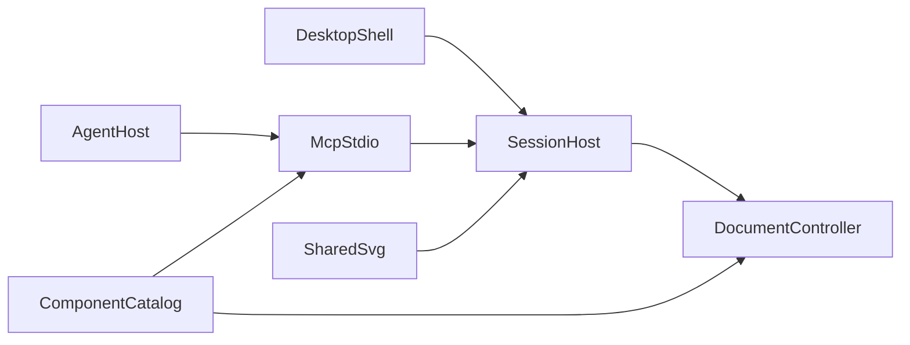

# 维护指南

这份文档说明 drawit 怎样保持一致，以及以后改代码时要守住的边界。使用者看 [guide.md](guide.md)。Agent 接入看 [mcp.md](mcp.md)。绘图样本看 [scenarios.md](scenarios.md)。

## 架构

唯一事实来源是 `DiagramDocument`。界面手势和 MCP 工具都变成 `DiagramOperation`，进入 `packages/core/src/controller.ts` 的单写队列。React Flow 只是投影，不要把画布状态写成文件。

- `revision` 只在内容提交时加一。选择、视口和悬停不增加版本。撤销和重做是一次新提交，版本继续增加。
- 修改必须带 `expectedRevision`。不一致时返回 `REVISION_CONFLICT`，文档不变。不要提供整份文档覆盖工具。
- 一批操作在副本上执行。结构错误则整批丢弃。重叠、越界和文字溢出是警告，不阻止保存。
- 打开中的文档只在 Session Host 里。Host 监听 `127.0.0.1` 的随机端口，把端口、令牌和进程号写入数据目录的 `session.json`。
- MCP 是另一个 stdio 进程。编辑器开着时只转发到会话；编辑器关着时才用同一个控制器读写文件。`diagram_open_editor` 不启动窗口，编辑器未运行时返回 `EDITOR_NOT_RUNNING`。
- 磁盘上的文件变了只提示。用户点“重新加载”才替换内存，并继续增加版本号。
- 预览、画布、导出和审查图共用 `packages/render` 的 SVG。审查结果是 MCP 图像，成功只表示图已生成。
- 不执行 Agent 提交的脚本或 HTML。不接云端识图。公式渲染关闭 KaTeX 的 `trust`。

错误码保持：`REVISION_CONFLICT`、`NOT_FOUND`、`VALIDATION_ERROR`、`SCHEMA_INCOMPATIBLE`、`EDITOR_NOT_RUNNING`、`PATH_FORBIDDEN`、`TRANSACTION_FAILED`、`EXPORT_FAILED`。



## 目录

- `packages/core`：文档 schema、操作、控制器、校验、组件注册表
- `packages/layout`：显式调用的 ELK 布局，跳过 `pinned` 节点
- `packages/render`：由文档生成 SVG，以及 PNG
- `packages/session`：本机 WebSocket 会话
- `packages/mcp`：stdio 工具
- `apps/desktop`：React 界面和 Tauri 壳
- `examples`：经正常打开路径载入的示例工程
- `docs/scenarios.md`：交给 Agent 的固定提示词

`.cursor/` 是个人编辑器配置，已在 `.gitignore` 中。不要把它加回仓库。MCP 配置由使用者按 [mcp.md](mcp.md) 写在自己的客户端里，或从安装版状态栏复制。

## 增加一种图元

1. 在 `packages/core/src/schema.ts` 增加节点类型和字段。未知字段收进 `meta`。更高且不兼容的 `schemaVersion` 直接拒绝。
2. 在 `packages/core/src/document.ts` 写默认几何。
3. 在 `packages/core/src/registry.ts` 登记类型、分类、默认值和关键词。`diagram_catalog` 读这里，不要在 MCP 描述里再抄一份。
4. 在 `packages/render/src/svg.ts` 用同一渲染器画出语义外观。语义字段必须留在节点上。
5. 若界面要编辑这些字段，改 `apps/desktop/src/Properties.tsx`。
6. 补 schema、往返保存和渲染测试。需要 Agent 回归时，往 `docs/scenarios.md` 加一条简略提示和一条详尽提示。

自动布局只在显式调用时运行。父子坐标与 React Flow 一致：没有父节点时相对画布，有 `parentId` 时相对父容器。

## 运行与检查

需要 Node.js 20+ 和 pnpm 10+。打包还需要 Rust stable，以及 Windows 的 Visual Studio C++ 与 WebView2、macOS 的 Xcode Command Line Tools，或 Linux 的 WebKitGTK 构建依赖。

```sh
pnpm install
pnpm dev
```

界面在 `http://127.0.0.1:1420`。桌面壳：

```sh
pnpm --filter @drawit/desktop tauri dev
```

提交前运行：

```sh
pnpm test
pnpm typecheck
```

涉及随包运行时或安装包时再运行：

```sh
pnpm bundle:runtime
pnpm test:runtime
pnpm --filter @drawit/desktop tauri build
```

`test:runtime` 会清空子进程 PATH，检查随包 Node、握手、工具目录、示例文档、审查 PNG，以及 Host 退出后的离线错误。集成测试需要本机 loopback 端口。

## 数据目录

- Windows：`%APPDATA%\drawit`
- macOS：`~/Library/Application Support/drawit`
- Linux：`$XDG_DATA_HOME/drawit`，未设置时是 `~/.local/share/drawit`
- `DRAWIT_HOME` 覆盖上述位置。改了之后，编辑器和 MCP 必须用同一个目录。

`documents/*.drawit.json` 是工程，`exports/` 是导出，`session.json` 是端口和令牌。保存先写临时文件再替换。路径不能逃出文档目录和导出目录。

## 打包

在目标系统和 CPU 架构上执行 `pnpm --filter @drawit/desktop tauri build`。构建会生成图标、打入当前平台的 Node 与 resvg，并把 MCP 和 Session Host 打成 CJS。安装后的桌面壳负责启动和关闭 Host。复制出来的 MCP 配置使用 `--mcp --runtime <安装资源目录>`。

产物在 `apps/desktop/src-tauri/target/release/bundle/`。可用 `--bundles nsis`、`--bundles dmg` 或 `--bundles deb` 选择格式。macOS 上若不能用 Finder 美化镜像，先 `tauri build --bundles app`，再在仓库根目录执行 `pnpm package:dmg`。

`runtime/` 由当前机器生成，不能拿到另一个系统复用，也不提交。开发时的 MCP 入口仍是 `tsx packages/mcp/src/index.ts`。不要把会在 `ws` 动态 `require` 上失败的 ESM 单文件交给客户端。stdio 上不打日志。

## 协议

会话的 WebSocket 消息保持向后兼容。MCP 继续接受 `2024-11-05`、`2025-03-26` 和 `2025-06-18` 的 `initialize`，同时接受 `2026-07-28` 信封。改协议时补 `packages/mcp/src/protocol.test.ts`。

## 不要做

不要加账号、云同步、付费识图，或执行 Agent 提交的 JavaScript。不要用旧快照覆盖整份文档。界面上不要留下没有接通的按钮。
